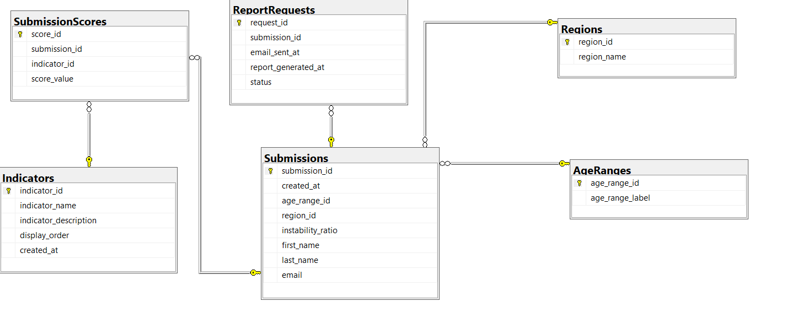

# Supabase → Azure SQL Migration: NBLK Stability Evaluation App

[](https://azure.microsoft.com/products/azure-sql/database/)
[-3ECF8E?logo=supabase)](https://supabase.com/)
[](https://github.com/mkleehammer/pyodbc)
[](https://www.reportlab.com/)

A data engineering solution (Azure Data Engineer internship task) for migrating the **NBLK Stability Evaluation** survey application from **Supabase (PostgreSQL)** to **Azure SQL Database**. The single flat Supabase export is redesigned into a **normalised relational schema** with lookup tables, a separate indicator-scores table and report-request tracking. A Python ETL script loads the export into SQL Server via **pyodbc**, verification and analytical SQL confirm the result, and a **ReportLab** script produces a per-respondent PDF stability report. The repo also includes an Azure deployment, security and migration plan with timeline and rollback strategy.

---

## 1. Solution Architecture & End-to-End Data Flow



### End-to-End Execution Flow
$$\text{Supabase (flat table)} \xrightarrow{\text{CSV export}} \text{survey\_responses\_rows.csv} \xrightarrow{\text{load\_data.py (pyodbc)}} \text{Azure SQL / SQL Server (normalised)} \xrightarrow{\text{SQL}} \text{Analytics} \xrightarrow{\text{report\_generator.py}} \text{PDF report}$$

1. **Source (Supabase):** One wide `survey_responses` table holding the respondent, five indicator ratings, the instability ratio and optional contact details.
2. **Export:** Rows are exported to `data/survey_responses_rows.csv` (100 sample rows).
3. **Schema deployment (`database/schema.sql`):** Creates six tables, seeds lookup data (5 indicators, 6 age ranges, 5 regions) and adds indexes.
4. **ETL (`database/load_data.py`):** Reads the CSV with pandas, maps text labels to surrogate keys from the lookup tables, inserts one `Submissions` row per response, unpivots the five rating columns into `SubmissionScores`, and queues a `ReportRequests` row — all in one transaction.
5. **Verification (`database/data_verification.sql`):** Confirms row counts and integrity after the load.
6. **Analytics (`database/analytical_queries.sql`):** Average score per indicator, scores by region and recent contactable submissions.
7. **Reporting (`scripts/report_generator.py`):** Builds a PDF for the latest submission with an email (example: `stability_report_<id>.pdf`).

---

## 2. Database Object Directory

| Table | Type | Purpose | Key Constraints |
| :--- | :--- | :--- | :--- |
| **`Indicators`** | Lookup | The five policy indicators and display order | `IDENTITY` PK |
| **`AgeRanges`** | Lookup | `18-24` … `65+` | `UNIQUE` label |
| **`Regions`** | Lookup | `northeast`, `midwest`, `southeast`, `southwest`, `west` | `UNIQUE` name |
| **`Submissions`** | Fact (header) | One row per survey response | `UNIQUEIDENTIFIER` PK (keeps Supabase UUIDs), FKs to `AgeRanges` and `Regions` |
| **`SubmissionScores`** | Fact (detail) | One row per indicator score | `CHECK (0–100)`, `UNIQUE (submission_id, indicator_id)`, `ON DELETE CASCADE` |
| **`ReportRequests`** | Workflow | Tracks report generation and email status | `status` default `'pending'` |

Indexes: `IX_Submissions_Email`, `IX_Submissions_CreatedAt`, `IX_SubmissionScores_Submission`.

---

## 3. Design Decisions (Flat Export vs. Normalised Model)

| Concern | Supabase Design | Azure SQL Design | Justification |
| :--- | :--- | :--- | :--- |
| **Indicator scores** | Five fixed `*_rate` columns | **`SubmissionScores` rows linked to `Indicators`** | New indicators can be added without a schema change; easy per-indicator aggregation |
| **Categorical values** | Free-text age range and region | **Lookup tables + foreign keys** | Consistent values and referential integrity |
| **Primary keys** | UUID | **`UNIQUEIDENTIFIER`** | Preserves source IDs so records can be traced back after migration |
| **Score validity** | Unchecked integers | **`CHECK (score_value BETWEEN 0 AND 100)`** | Rejects bad data at write time |
| **Email reports** | Not modelled | **`ReportRequests` table** | Tracks generation and send status per submission |
| **Load robustness** | — | **Skip invalid UUIDs and duplicates; roll back on any other error** | Re-runnable load that never leaves partial data |

---

## 4. Phase 1: Schema Deployment

```sql
CREATE TABLE Submissions (
    submission_id      UNIQUEIDENTIFIER PRIMARY KEY,
    created_at         DATETIME2 NOT NULL,
    age_range_id       INT,
    region_id          INT,
    instability_ratio  DECIMAL(5,2),
    first_name         NVARCHAR(100),
    last_name          NVARCHAR(100),
    email              NVARCHAR(255),
    FOREIGN KEY (age_range_id) REFERENCES AgeRanges(age_range_id),
    FOREIGN KEY (region_id)    REFERENCES Regions(region_id)
);

CREATE TABLE SubmissionScores (
    score_id       INT IDENTITY(1,1) PRIMARY KEY,
    submission_id  UNIQUEIDENTIFIER NOT NULL,
    indicator_id   INT NOT NULL,
    score_value    INT CHECK (score_value >= 0 AND score_value <= 100),
    FOREIGN KEY (submission_id) REFERENCES Submissions(submission_id) ON DELETE CASCADE,
    FOREIGN KEY (indicator_id)  REFERENCES Indicators(indicator_id),
    UNIQUE (submission_id, indicator_id)
);
```

Seed data: Economic Management, Immigration Policy, Foreign Policy, Domestic Policy and Social Policy indicators; six age ranges; five US regions.

---

## 5. Phase 2: ETL — Loading the Supabase Export

```python
indicator_mapping = {
    'economic_management_rate': 'Economic Management',
    'immigration_policy_rate':  'Immigration Policy',
    'foreign_policy_rate':      'Foreign Policy',
    'domestic_policy_rate':     'Domestic Policy',
    'social_policy_rate':       'Social Policy',
}

for csv_col, indicator_name in indicator_mapping.items():
    if pd.notna(row[csv_col]):
        cursor.execute("""
            INSERT INTO SubmissionScores (submission_id, indicator_id, score_value)
            VALUES (?, ?, ?)
        """, submission_id, indicators[indicator_name], int(row[csv_col]))
```

* Lookup tables are read once into dictionaries to map labels → IDs.
* Timestamps are parsed with `datetime.fromisoformat` after removing a `+00:00` UTC suffix.
* Missing values become `NULL`; invalid UUIDs and duplicate IDs are skipped.
* Any other error rolls back the whole transaction.

---

## 6. Phase 3: Verification & Analytical Queries

```sql
-- Average score per indicator
SELECT i.indicator_name,
       AVG(ss.score_value)   AS average_score,
       COUNT(ss.score_value) AS response_count
FROM SubmissionScores ss
JOIN Indicators i ON ss.indicator_id = i.indicator_id
GROUP BY i.indicator_id, i.indicator_name
ORDER BY i.indicator_id;
```

Also included: average score by region and indicator, and the most recent submissions with an email address.

---

## 7. Phase 4: PDF Report Generation

`scripts/report_generator.py` selects the latest submission with an email (`SELECT TOP 1 ... ORDER BY created_at DESC`), joins age range and region labels (`LEFT JOIN`, shown as `N/A` when missing), loads the indicator scores and renders a PDF with ReportLab tables. A sample output is committed as `stability_report_7E69B75A-....pdf`.

---

## 8. Phase 5: Azure Deployment & Migration Plan

### Recommended Azure SQL configuration
| Area | Recommendation |
| :--- | :--- |
| **Tier** | Standard S3 (100 DTUs), 250 GB storage, scale up for peaks |
| **Network** | Private Endpoint + VNet integration |
| **Authentication** | Microsoft Entra ID (Azure AD); app connects with **Managed Identity** |
| **Secrets (alternative)** | Connection strings in **Azure Key Vault**, read at runtime with rotation |
| **Encryption & audit** | Transparent Data Encryption and Azure SQL Auditing |

```text
Server=tcp:stability-sql.database.windows.net;Database=StabilityApp;Authentication=Active Directory Managed Identity
```

### Migration timeline (`migration/migration_plan.md`)
| Phase | Duration | Key Activities |
| :--- | :--- | :--- |
| Assessment | 2 days | Schema analysis, tool selection |
| Export | 1 day | Data extraction, backup |
| Transformation | 2 days | Data mapping, script development |
| Loading | 1 day | Initial load, validation |
| Testing | 2 days | Quality assurance, performance testing |
| Cutover | 1 day | Final sync, application switch |

**Rollback:** keep Supabase running during migration, use feature flags for gradual cutover, prepare rollback scripts and monitor after the switch.

### Future extensibility
* **Power BI:** DirectQuery dashboards for regional analysis, demographic trends and score distributions.
* **Azure Synapse Analytics:** path to large-scale analytics and ML.
* **Archival:** temporal tables for change tracking; old data to Azure Blob cold storage.

---

## 9. Repository Structure

```text
azure-data-engineer-task/
├── README.md
├── ERD.png                                   <-- Entity relationship diagram
├── stability_report_<id>.pdf                 <-- Sample generated report
├── data/
│   └── survey_responses_rows.csv             <-- Supabase export (100 sample rows)
├── database/
│   ├── schema.sql                            <-- Tables, seed data, indexes
│   ├── load_data.py                          <-- CSV → normalised tables (pyodbc)
│   ├── data_verification.sql                 <-- Post-load checks
│   └── analytical_queries.sql                <-- Reporting queries
├── migration/
│   └── migration_plan.md                     <-- Approach, timeline, rollback
└── scripts/
    └── report_generator.py                   <-- PDF report (ReportLab)
```

---

## 10. Complete Step-by-Step Reproduction Guide

### Prerequisites
* Python 3.8+
* SQL Server (local, Docker) or Azure SQL Database
* ODBC Driver 17 or 18 for SQL Server (18 was used here)

### Step 1: Install Python Packages
```bash
pip install pandas pyodbc reportlab
```

### Step 2: Create the Database
Create a database named `StabilityApp`, then run `database/schema.sql` in SSMS, Azure Data Studio or `sqlcmd`.

### Step 3: Configure the Connection
Edit `connection_string` in `database/load_data.py` (default `SERVER=localhost\SQLEXPRESS`) and `scripts/report_generator.py` (set to a named machine; change it to your server). Both use `DATABASE=StabilityApp`.

### Step 4: Load the Data
```bash
python database/load_data.py
```

### Step 5: Verify and Query
Run `database/data_verification.sql`, then `database/analytical_queries.sql`.

### Step 6: Generate a Report
```bash
python scripts/report_generator.py
```

---

## Contact
For questions about this solution: munatsialwyn26@gmail.com
